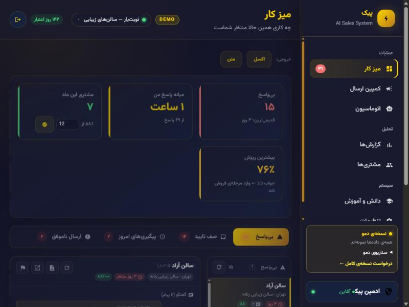
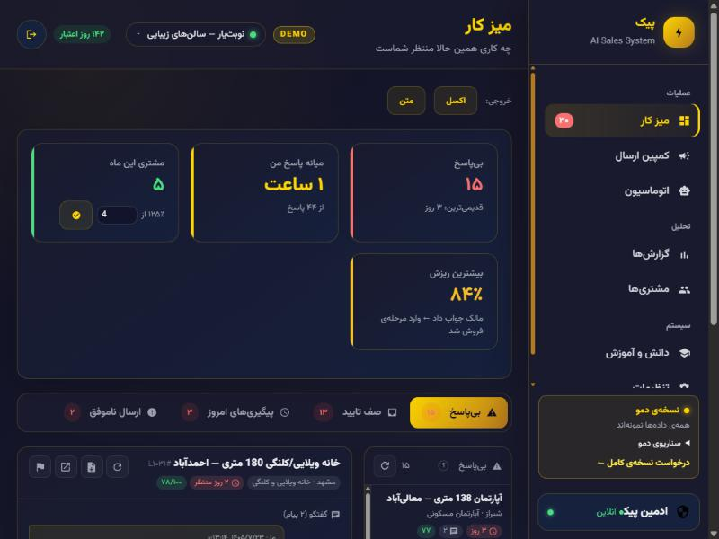
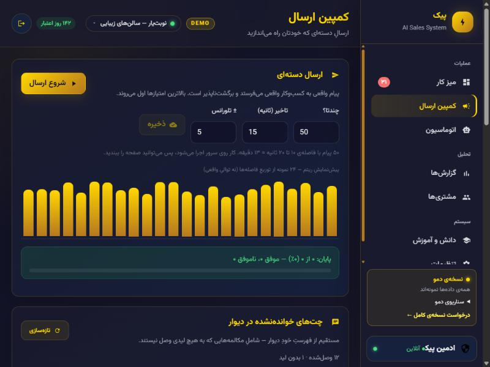
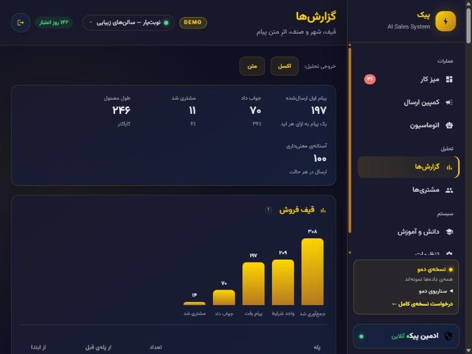
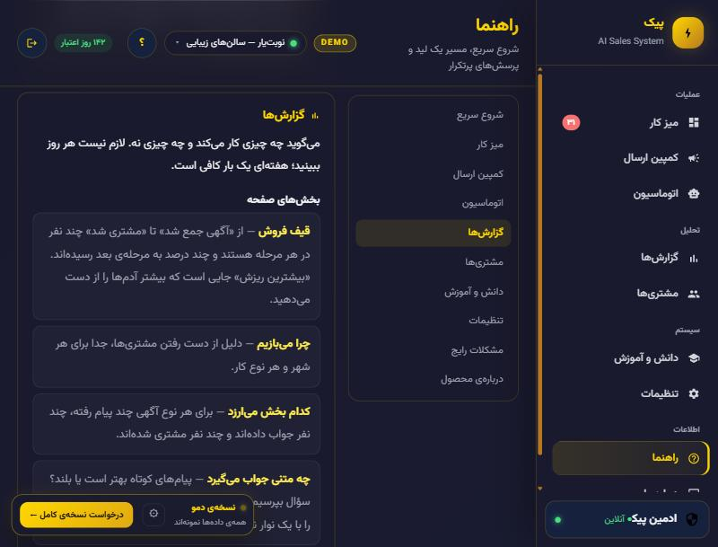
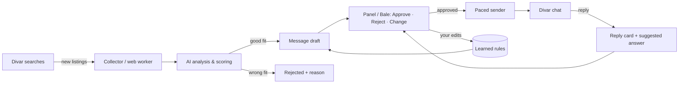

# Peik (پیک) — AI Sales System

**Finds the right Divar listings, writes the first message, and handles the replies — you approve with one tap.** 
*Self-hosted. One phone number = one business. Everything stays on your server.*

### 🟢 [**→ Live Demo — try it now, no install needed**](https://javiddeveloper.github.io/Hermes-Divar-Sell-agent-DEMO/)

-orange.svg)

[**Live Demo**](https://javiddeveloper.github.io/Hermes-Divar-Sell-agent-DEMO/) • [**Screenshots**](#-interface) • [**Capabilities**](#-core-capabilities) • [**Architecture**](#%EF%B8%8F-architecture) • [**Get it for your business**](#-get-it-for-your-business)

---

## ⚡ What is Peik?

Selling to small businesses (or to private owners) on Divar means scrolling hundreds of listings, writing the same careful message again and again, and then forgetting who replied. Most outreach tools just blast text. Peik does the whole job the way a good salesperson would:

1. **Collect & judge** — it watches the Divar searches you define, reads every new listing and scores how well the advertiser fits *your* product. Wrong fit (an agency when you sell to owners, a chain when you sell to one-chair salons) is rejected before anyone is messaged.
2. **Write & approve** — for each good lead it drafts a short, human first message that mentions the real details of the listing. You see it in the panel (or in a **Bale** chat) and tap **Approve / Reject / Needs a change**. Your manual edits teach it your style.
3. **Follow the conversation** — replies from Divar chat come back with a suggested answer and the same three buttons. Silent leads get a soft nudge after a few days, never a blast.
4. **Learn what works** — funnel, city and time-of-day analysis, and which message styles actually get replies.

> [!IMPORTANT]
> **This is a demo.** It runs entirely in your browser on built-in, fictional sample data. Nothing is sent to Divar or anyone else, and no real ad, person or phone number appears (all numbers are placeholders).

---

## ⏱️ Try It in 60 Seconds

> **[→ Open the live demo](https://javiddeveloper.github.io/Hermes-Divar-Sell-agent-DEMO/)** — password for everything: **`123456`** (also shown on the lock screen).

| Page | Link | What to look at |
|---|---|---|
| Work desk | [#command](https://javiddeveloper.github.io/Hermes-Divar-Sell-agent-DEMO/#command) | Who is waiting for *my* answer, drafts awaiting approval, failed sends, follow-ups due today. Approve a draft and watch every counter change |
| Send campaign | [#campaign](https://javiddeveloper.github.io/Hermes-Divar-Sell-agent-DEMO/#campaign) | Press **Start** — messages go out one by one at a human pace (compressed in the demo) with live progress |
| Automation | [#automation](https://javiddeveloper.github.io/Hermes-Divar-Sell-agent-DEMO/#automation) | Collection health, Divar session, auto-send limits, a chat-sync run you can start and undo |
| Reports | [#reports](https://javiddeveloper.github.io/Hermes-Divar-Sell-agent-DEMO/#reports) | Funnel, bottlenecks, loss reasons, best cities and hours, message-style analysis, CSV export |
| Customers | [#customers](https://javiddeveloper.github.io/Hermes-Divar-Sell-agent-DEMO/#customers) | Converted customers, median time-to-convert, add a manual customer |
| Knowledge | [#knowledge](https://javiddeveloper.github.io/Hermes-Divar-Sell-agent-DEMO/#knowledge) | Product profile, search targets with real yield, rules learned from your edits, sample images |
| Help | [#help](https://javiddeveloper.github.io/Hermes-Divar-Sell-agent-DEMO/#help) | Plain-language guide for non-technical users: step-by-step for every page, common problems, searchable. The **?** button in the header opens the guide for the page you are on |
| About | [#us](https://javiddeveloper.github.io/Hermes-Divar-Sell-agent-DEMO/#us) | Who built it, how to reach the author, the 3-step trial with your device ID |
| Settings | [#settings](https://javiddeveloper.github.io/Hermes-Divar-Sell-agent-DEMO/#settings) | AI model, Divar account, Bale bot, license, **businesses** |

### Two businesses, one panel

Use the business chip in the header (next to the `DEMO` label) to switch — exactly as the real product does, with the same slow, careful switch:

| Business | What it sells | Who it targets on Divar |
|---|---|---|
| **نوبت‌یار — سالن‌های زیبایی** | Smart appointment book for salons and clinics | Beauty salons, nail/lash studios, skin & laser clinics, barbers |
| **املاک آرمان‌شهر — فروش خانه از مالک** | Brokerage service for houses | **Ordinary people selling their own home.** Ads saying "agents don't call" are rejected and never messaged; an owner who says "no agency" is blocked for good |

Same engine, completely different data, wording, labels and numbers.

**Demo scenarios** — the same product in other situations:

- [Fresh install](https://javiddeveloper.github.io/Hermes-Divar-Sell-agent-DEMO/?scenario=fresh) — the 8-step setup wizard (password, license, model, Divar login, Bale, profile)
- [Half configured](https://javiddeveloper.github.io/Hermes-Divar-Sell-agent-DEMO/?scenario=partial#automation) — no Divar session, no model key, stuck analyses, a stale knowledge base
- [Services down](https://javiddeveloper.github.io/Hermes-Divar-Sell-agent-DEMO/?scenario=errors#automation) — expired Divar session, model timeouts, rate-limited sends

---

## 📸 Interface

| | |
|---|---|
|    **Work desk — salons** |    **Work desk — real estate (after switching business)** |
|    **Send campaign** |    **Automation & health** |
|    **Reports** |    **Customers** |
|    **Product profile & knowledge** |    **Help** |
|    **About** |    **Lock screen** |

---

## 🎯 Who Is This For?

- **Service businesses selling B2B on Divar** — appointment software, accounting, delivery, marketing — where every prospect posts a public ad.
- **Agents who buy from private owners** — houses, apartments, land listed directly by their owners.
- **Small sales teams** who want a daily "what needs me now" list instead of a spreadsheet.
- Operators who run **more than one business** and want each to keep its own leads, rules and numbers.

---

## 🌟 Core Capabilities

### 1. Listing triage that respects your product
Every new ad is read and scored against your profile. Out-of-profile advertisers are rejected with a reason you can read, so you can tune the profile instead of guessing.

### 2. A message you'd actually send
Short, informal, specific to the ad (area, size, service). One tap to approve; "Needs a change" lets you rewrite it and Peik turns your diff into a rule it follows from then on.

### 3. Conversation, not blasting
Replies come back as cards with a suggested answer. Nudges are soft, spaced, limited per day and restricted to hours you choose. Opt-outs ("don't call me") are respected permanently.

### 4. Built for operations
Live logs, daily caps, rate-limit awareness, a Divar session health check, slow human-paced batches, and a Bale bot so you can approve from your phone.

---

## 🥊 How It Compares

| | Spreadsheet + copy-paste | Bulk messaging tools | **Peik** |
|---|---|---|---|
| Reads the ad before writing | You do | No | ✅ |
| Rejects wrong-fit advertisers | You do | No | ✅ with a reason |
| Personalised message | Copy-paste | Template | ✅ per listing |
| Human approval step | — | No | ✅ one tap |
| Handles replies | Manual | No | ✅ suggested answer |
| Respects opt-outs | Easy to forget | No | ✅ blocked permanently |
| Learns from your edits | No | No | ✅ |
| Data location | Your laptop | Vendor cloud | **Your server** |

---

## 🏛️ Architecture

The demo replaces the server with an in-browser simulation of the same API, so every screen, number and action is real UI logic on top of sample data.

---

## 🏢 Get It for Your Business

This repository contains only the public demo. **Peik is a commercial product**, installed on your own server by its author:

- Installation and setup for your business (or several, one phone number each)
- Search targets, product profile and tone tuned to what you sell
- Divar and Bale connection, model choice (including private gateways)
- Ongoing support

**Contact — Javid Sattar**
- 📧 [javiddeveloper@gmail.com](mailto:javiddeveloper@gmail.com?subject=Peik)
- 💼 [LinkedIn](https://www.linkedin.com/in/javid-sattar/)
- 🐙 [GitHub @javiddeveloper](https://github.com/javiddeveloper)
- 📸 [Instagram @javiddev](https://www.instagram.com/javiddev)

---

## 🇮🇷 پیک به فارسی

سیستم فروش هوشمند روی دیوار: آگهی‌های مناسب را پیدا می‌کند، پیام اول را می‌نویسد، جواب‌ها را پیگیری می‌کند — و هر پیام قبل از ارسال با یک لمس تایید شما را می‌گیرد.

- **غربال آگهی** — هر آگهی با پروفایل محصول شما سنجیده می‌شود؛ مشتری نامناسب با دلیل رد می‌شود.
- **پیام انسانی و اختصاصی** — با جزئیات خود آگهی؛ «تایید / لغو / نیاز به تغییر» در پنل یا ربات بله. ویرایش‌های شما به قانون تبدیل می‌شود.
- **گفتگو، نه ارسال انبوه** — جواب مشتری با پیشنهاد پاسخ می‌آید؛ پیگیری نرم، با سقف روزانه و بازه‌ی ساعتی؛ «تماس نگیرید» برای همیشه رعایت می‌شود.
- **دو کسب‌وکار، یک پنل** — مثلاً سالن‌های زیبایی و **فروش خانه از مالک‌های عادی** (آگهی‌هایی که نوشته‌اند «مشاور املاک تماس نگیرد» اصلاً پیام نمی‌گیرند). هر شماره = یک کسب‌وکار.
- **گزارش‌ها** — قیف فروش، شهر و ساعت بهتر، کدام سبک پیام جواب می‌گیرد.
- **روی سرور خودتان** — داده و توکن‌ها جایی نمی‌روند.

**[▶ باز کردن دموی آنلاین](https://javiddeveloper.github.io/Hermes-Divar-Sell-agent-DEMO/)** — رمز: `123456`؛ همه‌چیز با داده‌ی نمونه‌ی ساختگی در مرورگر اجرا می‌شود و به دیوار یا هیچ‌کس پیامی نمی‌رود.

این مخزن فقط نسخه‌ی نمایشی است. خود محصول تجاری است و روی سرور شما نصب و راه‌اندازی می‌شود: [javiddeveloper@gmail.com](mailto:javiddeveloper@gmail.com?subject=Peik)

---

© Javid Sattar. All rights reserved. This demo is provided for evaluation only; the product source is not included. All businesses, listings, people and phone numbers in the demo are fictional.
